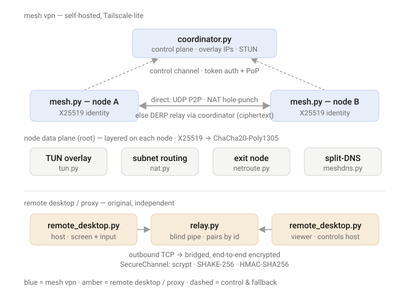
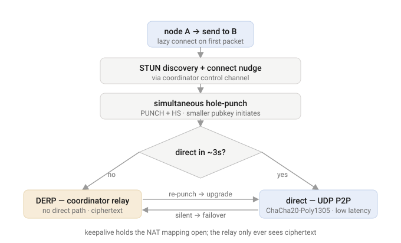
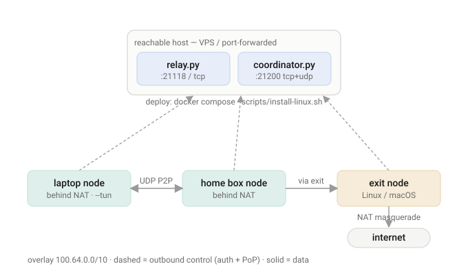

**English** | [繁體中文](README.zh-TW.md)

# RemoteMac self-hosted relay

Self-hosted remote desktop, encrypted proxy, and an experimental mesh VPN. The
remote desktop and proxy connect through a relay, so the controlled machine
needs no inbound port.

> **Just want to get it running?** See **[INSTALL.md](INSTALL.md)** — a step-by-step install & deploy guide (Docker or manual).

| File | Role | Where it runs |
|---|---|---|
| `relay.py` | Rendezvous server (blind pipe) | A VPS / home box you control |
| `remote_desktop.py` | Encrypted transport + remote desktop + SOCKS5 proxy (five modes) | Mac / Linux |
| `coordinator.py` | Mesh control plane and STUN responder | A reachable VPS / home box |
| `mesh.py` | Encrypted mesh node, optional TUN and gateway | Mac / Linux / Windows client |
| `mac-native/` | Native Swift viewer for a Python remote-desktop host | macOS |

Remote desktop / proxy connection:

```
 Machine A  ──outbound──►  YOUR RELAY  ◄──outbound──  Machine B
  (client)    (encrypted)    (blind)     (encrypted)    (host)
```

---

## Architecture

Overall system — the mesh VPN (coordinator control plane + nodes with a UDP P2P
data plane) and the original remote-desktop / proxy:



<details><summary>More diagrams — data-plane connection flow &amp; deployment topology</summary>

Data plane: hole punching and the transparent direct↔DERP switching —



Deployment: where each piece runs —



</details>

### relay.py — the blind pipe

The relay does exactly one thing: pair two outbound TCP connections and forward bytes in both directions. It **never sees plaintext**, because encryption and decryption happen at the two endpoints.

- No database, stores nothing
- Runs as `nobody` (the systemd unit is preconfigured)
- Built-in DoS protection: max 5 concurrent connections per IP, max 10,000 registered hosts

For Python hosts, set `REMOTEMAC_RELAY_HOST_TOKEN` to the same strong secret on
the relay and each host. The relay then challenges a host before reserving its
device ID. Legacy Mac/iPad hosts do not implement this registration extension;
leave the variable unset when using them. In legacy mode, anyone who knows a
device ID can occupy its relay slot until that connection closes.

### remote_desktop.py — encrypted channel + remote desktop

Once the relay has bridged the two connections, `remote_desktop.py` runs a **mutually authenticated + encrypted** protocol on top:

```
[relay bridge established → 'P']
        │
        ▼
① Exchange random nonces (32 bytes each)
        │
        ▼
② scrypt key derivation
   master = scrypt(PSK, salt=nonce_h‖nonce_c, N=16384, r=8, p=1)
   → 5 independent subkeys (enc_h2c, enc_c2h, mac_h2c, mac_c2h, auth)
        │
        ▼
③ Mutual token exchange
   token = HMAC-SHA256(auth_key, role‖nonce_h‖nonce_c)
   Both sides verify with compare_digest → abort if either lacks the PSK
        │
        ▼
④ Data transfer (per frame)
   ┌──────────┬──────────────────────┬────────────────────┐
   │ 4 B len  │ 32 B HMAC-SHA256 MAC │ N B ciphertext     │
   └──────────┴──────────────────────┴────────────────────┘
   Encryption: SHAKE-256 XOF counter-mode (111 MB/s, one Keccak call/frame)
   Integrity:  HMAC-SHA256(mac_key, seq_num‖ciphertext); seq_num prevents replay
```

---

## Security summary

| Threat | Mitigation |
|---|---|
| Eavesdropping relay traffic | SHAKE-256 encryption; the relay only sees ciphertext |
| Man-in-the-middle impersonation | Mutual token verification; both sides must know the PSK |
| Weak-PSK brute force | scrypt(N=16384) makes each guess cost ~50 ms + 16 MB RAM |
| Frame forgery / tampering | HMAC-SHA256 per-frame MAC, constant-time comparison |
| Replay attacks | Monotonic 64-bit sequence number, independent per direction |
| Frame flooding | Receiver caps at 5,000 frames/s |
| Connection squatting | 30 s auth timeout; idle connections dropped after 120 s |
| Giant frames exhausting memory | 4 MB per-frame limit |

> **Note**: the encryption layer in remote_desktop.py is unrelated to the RemoteMac app's TLS-PSK — they are independent encryption layers. remote_desktop.py is a standalone remote-desktop / encrypted-tunnel tool, not a replacement for the app.

---

## Requirements

- Python 3.8+ for the Python components. The relay and `pipe` / `gateway` /
  `socks` modes need no pip packages; the mesh needs `cryptography`.
- Python desktop `host` / `viewer` modes need `mss Pillow pynput` / `Pillow`
  respectively. The native viewer needs macOS and a Swift toolchain to build.
- The relay server must be reachable from the internet (a VPS, or a home box with port forwarding)

---

## 1. Set up relay.py (server side)

### 0. Check the Python version

```bash
python3 --version   # needs 3.8+
```

If it's missing:

```bash
# Debian / Ubuntu / Raspberry Pi OS
sudo apt update && sudo apt install -y python3

# Fedora / RHEL / CentOS / Rocky / Alma
sudo dnf install -y python3

# Arch / Manjaro
sudo pacman -S --noconfirm python

# Alpine
sudo apk add python3
```

### 1. Copy the files to the server

```bash
scp relay.py remotemac-relay.service you@YOUR_SERVER:~/
```

### 2. Test first (foreground)

```bash
ssh you@YOUR_SERVER
python3 relay.py 21118
# you should see: RemoteMac relay listening on 0.0.0.0:21118
```

Confirm the port is listening:

```bash
ss -tlnp | grep 21118
```

Press **Ctrl-C** to stop.

### 3. Install as a systemd service (recommended)

```bash
sudo mkdir -p /opt/remotemac
sudo cp relay.py /opt/remotemac/
sudo cp remotemac-relay.service /etc/systemd/system/
sudo systemctl daemon-reload
sudo systemctl enable --now remotemac-relay
sudo systemctl status remotemac-relay        # confirm active (running)
```

Watch the live log:

```bash
journalctl -u remotemac-relay -f
# host registered → Mac has connected
# bridging        → a session is in progress
```

Without systemd (Alpine / container / WSL):

```bash
mkdir -p ~/.local/state/remotemac
nohup python3 /opt/remotemac/relay.py 21118 > ~/.local/state/remotemac/relay.log 2>&1 &
```

To change the port: edit `ExecStart=` in `/etc/systemd/system/remotemac-relay.service`, then:

```bash
sudo systemctl daemon-reload && sudo systemctl restart remotemac-relay
```

### 4. Open the firewall

```bash
# ufw (Debian/Ubuntu)
sudo ufw allow 21118/tcp

# firewalld (Fedora/RHEL)
sudo firewall-cmd --add-port=21118/tcp --permanent && sudo firewall-cmd --reload

# iptables
sudo iptables -A INPUT -p tcp --dport 21118 -j ACCEPT
```

Cloud VMs (AWS / GCP / Azure / DigitalOcean) also need 21118/tcp opened for inbound traffic in the console's security-group / firewall rules.

### 5. Verify external reachability

```bash
# find the public IP on the server
curl -s https://api.ipify.org; echo

# test from another machine (e.g. your Mac)
nc -vz YOUR_RELAY_IP 21118     # should print succeeded / open
```

### Managing the service

```bash
sudo systemctl restart remotemac-relay
sudo systemctl stop remotemac-relay
sudo systemctl disable --now remotemac-relay
journalctl -u remotemac-relay -e          # view recent logs
```

Update the relay:

```bash
sudo cp relay.py /opt/remotemac/ && sudo systemctl restart remotemac-relay
```

Remove completely:

```bash
sudo systemctl disable --now remotemac-relay
sudo rm /etc/systemd/system/remotemac-relay.service /opt/remotemac/relay.py
sudo systemctl daemon-reload
```

---

## Deploy the servers with Docker (relay + coordinator)

The two server daemons — `relay.py` and the mesh `coordinator.py` — run as
non-root containers (the image installs `cryptography` for the coordinator; the
relay is pure stdlib). One command brings both up:

```bash
cp docker/.env.example .env          # then set REMOTEMAC_MESH_TOKEN to a strong secret
docker compose up -d --build
docker compose logs -f               # relay + coordinator logs
```

- **relay** listens on `21118/tcp`; **coordinator** on `21200` (tcp control + udp
  STUN). Open those in your firewall / cloud security group.
- The mesh token is passed via `REMOTEMAC_MESH_TOKEN` (from `.env`) — never baked
  into the image. Every mesh node must join with the same token.
- Coordinator overlay-IP assignments persist in the `coordinator-state` volume, so
  nodes keep their IPs across restarts.
- Only the relay + coordinator are containerized. Mesh nodes with `--tun`
  (`--exit` / subnet routers) need `NET_ADMIN` + `/dev/net/tun`, and the
  remote-desktop `host` mode needs a real desktop — those run on the host directly.

```bash
docker compose down                  # stop; add -v to also drop the state volume
```

---

## 2. Configure the RemoteMac app (Mac + iPad)

This section applies if you already have the separate legacy Mac and iPad apps;
their source and binaries are not included in this repository. For the Python
host and viewer or the Swift viewer built here, use section 3.

### On the Mac

```bash
echo "YOUR_RELAY_IP:21118" > ~/.config/remotemac/relay
pkill -9 -f "RemoteMac Host.app"
open -W "/Applications/RemoteMac Host.app"
```

The relay log should show: `host registered id=...`

### On the iPad

**Settings ▸ Relay server** → enter `YOUR_RELAY_IP:21118`.

### Connection flow

1. Enter the Device Code on the iPad.
2. Same Wi-Fi → direct LAN connection (fastest); the relay is not used.
3. Different networks / cellular → both sides connect to the relay → bridged → connected.

---

## 3. Using remote_desktop.py

`remote_desktop.py` bundles the encrypted transport, remote desktop, and encrypted proxy features, with five modes:

| Mode | Description | Dependencies |
|---|---|---|
| `host` | Controlled side: streams the screen + receives injected keyboard/mouse | `mss Pillow pynput` |
| `viewer` | Controlling side: displays the screen + sends keyboard/mouse | `Pillow` (with tkinter) |
| `pipe` | stdin/stdout encrypted bridge, no GUI | none (Python stdlib) |
| `gateway` | Exit node: opens outbound TCP/UDP on behalf of the client | none (Python stdlib) |
| `socks` | Local SOCKS5 proxy entry point; sends other apps' traffic through the encrypted tunnel | none (Python stdlib) |

### Install dependencies (host / viewer modes)

```bash
pip install mss Pillow pynput
```

### macOS native viewer

[`mac-native/`](mac-native/) includes an AppKit viewer for `remote_desktop.py host`.
On macOS, run `./mac-native/build-app.sh` to create
`mac-native/dist/RemoteMac Viewer.app`. Its encrypted transport passes Swift and
Python interoperability tests; live screen and input interaction still needs
testing with a real host. Plain-text clipboard sync is implemented in both
directions; its GUI behavior still needs live testing. See the
[native viewer guide](mac-native/README.md) for build and connection details.

### macOS permissions

| Side | Permission needed |
|---|---|
| host | **Screen Recording** (System Preferences > Privacy > Screen Recording) |
| host | **Accessibility** (System Preferences > Privacy > Accessibility) — for keyboard/mouse injection |

### Starting remote control

```bash
# 1. Run the host side first (the controlled machine, waits for a peer)
python3 remote_desktop.py host relay.example.com:21118 mydevice --psk "strong-passphrase"

# 2. Run the viewer side (the controlling machine)
python3 remote_desktop.py viewer relay.example.com:21118 mydevice --psk "strong-passphrase"
```

Host mode is **persistent by default**: after a viewer disconnects it re-registers with the relay and waits for the next connection; if it can't reach the relay it retries with exponential backoff (2s → 30s). Add `--once` to restore the "exit after a single session" behavior.

> **Security note**: a value passed via `--psk` can be seen on Linux with `ps aux`. Safer options:
> - Omit `--psk` — the program prompts interactively (not echoed to the screen)
> - Or set an environment variable: `export REMOTEMAC_PSK="your-passphrase"`, then omit `--psk`

On success:
```
[remotemac] relay: registered — waiting for peer…    ← host side
[remotemac] auth: mutual authentication succeeded ✓

[remotemac] relay: bridge established                 ← viewer side
[remotemac] auth: mutual authentication succeeded ✓
```

The viewer opens a window showing the host's screen; your mouse and keyboard input are relayed to the host in real time.

### Options

| Option | Modes | Description | Default |
|---|---|---|---|
| `--fps N` | host | Capture frame rate | 15 |
| `--quality N` | host | JPEG quality 20–95 | 75 |
| `--once` | host | Exit after a single session (default: persistent re-registration) | off |
| `--no-clip` | host / viewer | Disable bidirectional clipboard sync | off (sync on) |

```bash
# High quality (needs a good network)
python3 remote_desktop.py host relay.example.com:21118 myid --psk "pw" --fps 30 --quality 85

# Save bandwidth
python3 remote_desktop.py host relay.example.com:21118 myid --psk "pw" --fps 10 --quality 60
```

### Supported input

| Type | Notes |
|---|---|
| Mouse movement | Full-screen coordinates normalized; auto-adapts to different resolutions |
| Left / right / middle button | Press and release |
| Scroll wheel | Works on macOS / Linux / Windows |
| Keyboard | Regular characters + F1–F12 + Ctrl / Alt / Shift / ⌘ / arrow keys, etc. |
| Clipboard | Bidirectional auto-sync (plain text, polled every second; disable with `--no-clip`) |

### Pipe mode (CLI tools / script integration)

No GUI — just a stdin/stdout bridge, ideal for file transfer, remote command execution, etc.:

```bash
# Transfer a file (host side sends to client side)
cat file.bin | python3 remote_desktop.py pipe relay.example.com:21118 myid host --psk "pw"
python3 remote_desktop.py pipe relay.example.com:21118 myid client --psk "pw" > output.bin

# Remote bash
bash | python3 remote_desktop.py pipe relay.example.com:21118 myid host --psk "pw"
python3 remote_desktop.py pipe relay.example.com:21118 myid client --psk "pw"
```

### Encrypted SOCKS5 proxy (gateway / socks modes)

Beyond remote desktop, you can route other apps' traffic on the client machine (browser, curl, …) **out through the host over the encrypted tunnel** — a self-hosted, encrypted `ssh -D`. Many connections are multiplexed over a single relay bridge, all using the same crypto (scrypt auth + SHAKE-256 + HMAC); the relay still only sees ciphertext.

```bash
# 1. gateway (the exit machine, e.g. your Mac at home; persistent, auto-reconnects)
python3 remote_desktop.py gateway relay.example.com:21118 myproxy --psk "pw"

# 2. socks (your local machine, opens a local SOCKS5 proxy)
python3 remote_desktop.py socks relay.example.com:21118 myproxy --psk "pw" --port 1080

# 3. Send apps through the proxy (socks5h → DNS resolution also goes remote)
curl -x socks5h://127.0.0.1:1080 https://api.ipify.org        # shows the gateway's public IP
ALL_PROXY=socks5h://127.0.0.1:1080 curl https://example.com
```

Point a browser at SOCKS5 host `127.0.0.1`, port `1080` to route everything through the tunnel.

- **Supported**: TCP (SOCKS5 CONNECT) + UDP (SOCKS5 UDP associate, e.g. DNS/QUIC); domain names are resolved on the gateway side.
- **Security**: anyone connecting into the gateway must pass mutual PSK authentication or the connection is dropped, so it won't become an open proxy.

| Option | Modes | Description | Default |
|---|---|---|---|
| `--port N` | socks | Local SOCKS5 listen port | 1080 |
| `--bind ADDR` | socks | Local bind address | 127.0.0.1 |
| `--allow HOST/CIDR` | gateway | Allowlist (domain suffix or IP/CIDR), repeatable; omit to allow all | none (allow all) |
| `--once` | gateway | Exit after a single session (default: persistent reconnect) | off |

> **Defense in depth**: `socks` binds only to `127.0.0.1` by default, so other machines can't piggyback on your proxy; think twice before exposing it with `--bind 0.0.0.0`. To tighten the `gateway` further, use `--allow` (e.g. `--allow example.com --allow 10.0.0.0/8`) to restrict reachable targets — anything not listed is rejected.

### Choosing a PSK

| Strength | Example |
|---|---|
| Weak (not recommended) | `1234`, `password` |
| Acceptable | `correct-horse-battery-staple` |
| Strong (recommended) | `python3 -c "import secrets; print(secrets.token_hex(24))"` |

---

## 4. Mesh overlay (experimental)

Beyond the 1:1 remote-desktop model, `coordinator.py` + `mesh.py` grow the system
into a **mesh** (a self-hosted, Tailscale-lite network): many nodes join one
network, each gets a stable overlay IP, and node↔node traffic is end-to-end
encrypted and, wherever the network allows, sent **peer-to-peer over UDP** rather
than through the coordinator. Requires `cryptography` (`pip install cryptography`).

```bash
# Coordinator (on your reachable host — control plane + STUN, sees only ciphertext)
python3 coordinator.py 21200 --token "network-secret"

# Each node joins the network (opens a UDP data-plane port; --udp-port to pin it)
python3 mesh.py up coord.example.com:21200 --token "network-secret" --name laptop
python3 mesh.py up coord.example.com:21200 --token "network-secret" --name mac

# Prove the encrypted path — the log shows [direct: …] or [derp …]
python3 mesh.py up coord.example.com:21200 --token "network-secret" --ping mac
```

- Each node has a persistent X25519 identity (`~/.config/remotemac/mesh/key`,
  overridable with `$REMOTEMAC_MESH_KEY`); the coordinator assigns stable IPv4
  overlay addresses from `100.64.0.0/10` and IPv6 addresses from a per-mesh ULA
  `/64`. The IPv6 prefix is stored with the coordinator's address assignments.
- Node↔node handshake is mutually authenticated and forward-secret (X25519
  triple-DH → HKDF-SHA256 → ChaCha20-Poly1305). The INIT is itself authenticated
  and timestamped (forged or replayed handshakes are dropped), the RESP is
  key-confirmed, sessions rekey every 2 minutes and recover when a peer restarts,
  and a direct path only moves on authenticated, non-replayed data.
- **Direct P2P (Phase 2).** Nodes discover their public endpoint via a STUN-lite
  probe to the coordinator, exchange candidates, and **hole-punch a direct UDP
  path** (simultaneous punching; a deterministic pubkey tie-break avoids handshake
  glare). Data then flows straight between peers. If no direct path forms within a
  few seconds (e.g. a symmetric-NAT pair), traffic transparently **falls back to
  the coordinator relay (DERP)** — which only ever sees ciphertext. A keepalive
  holds the NAT mapping open; a silent direct path fails over to DERP and is
  periodically re-punched so it can upgrade back to direct once reachable.
- **TUN overlay (Phase 3).** With `--tun` (needs root or Windows Administrator), the node brings up a
  virtual interface, assigns its overlay IPs, and routes the IPv4 and IPv6
  overlay networks to it — so **real apps reach peers by overlay IP**
  (`ping 100.64.0.x`, `ssh`, http),
  not just the built-in `--ping`. Kernel IP packets are carried over the same
  encrypted P2P/DERP data path. macOS uses `utun` (no kext); Linux uses
  `/dev/net/tun`; Windows clients use the separately supplied official
  [Wintun DLL](https://www.wintun.net/). A peer may only inject packets sourced from its own overlay IP
  (anti-spoof).
- **Subnet routing (Phase 4).** A node can be a **subnet router**: with
  `--advertise-routes 192.168.1.0/24` it announces LAN CIDRs it can reach and sets
  up IP forwarding + masquerade on Linux or macOS, so other nodes reach hosts
  *behind* it. A client explicitly grants one CIDR to one peer public key with
  `--accept-route PUBKEY,CIDR`, installs that route via its TUN, and sends matching
  traffic to that peer. Only the
  named subnets go through the mesh — the default route is untouched. Advertised
  CIDRs that overlap the overlay or contain the coordinator / a peer endpoint are
  refused (so mesh transport can't loop), and a subnet router may source replies
  from within the routes you accepted (anti-spoof stays enforced otherwise).
- **Exit node (Phase 5, opt-in).** A macOS or Linux node started with `--exit`
  forwards IPv4 internet traffic; `--exit-ipv6` also enables IPv6 forwarding and
  NAT66. A client selects its public key with `--exit-node PUBKEY`. The client
  binds mesh transport to its physical interface, then installs IPv4 /1 routes
  and, if the exit advertises IPv6 support, IPv6 /1 routes through the TUN.
  Route setup errors abort startup. Without `--exit-node`, default routes stay
  untouched. Windows full-tunnel exit clients and Windows gateways are not yet
  supported.
- **split-DNS (Phase 8, opt-in).** With `--dns`, a node runs a local resolver at
  `127.0.0.1:53` for `.mesh` A and AAAA records. By default, peers resolve by a
  label derived from their full public key (`mesh.py key --dns-label`), or by an
  alias explicitly bound to a public key (`--dns-pin gw=PUBKEY`). An advertised
  `--name` alone is not a trusted DNS name. macOS uses `/etc/resolver/mesh`, Linux
  uses a systemd-resolved route-only domain with DNS default routing disabled,
  and Windows uses an NRPT suffix rule. Other domains keep using the OS resolver.
  On Linux without systemd-resolved, `--dns` fails and leaves the system
  resolver unchanged. `--dns-global-fallback` explicitly opts in to a
  reversible rewrite of a plain, unmanaged `/etc/resolv.conf`; non-mesh queries
  then go to the saved or `--dns-upstream` resolver.
- **IPv6 overlay and routes (Phases 9–11).** Peers receive stable ULA addresses
  and exchange IPv6 packets through the same encrypted TUN data path. IPv6
  subnets use the same explicit `--advertise-routes` / `--accept-route` grants
  as IPv4. Linux and macOS gateways apply scoped NAT66 for IPv6 routes and exits.
  Direct UDP and coordinator relay transport still use IPv4.
- **macOS gateway (Phase 10).** macOS uses a scoped PF NAT anchor for subnet
  routing and exit traffic. A macOS gateway advertises its routes or exit status only
  after TUN and NAT setup succeeds. Upgrade the coordinator before enabling
  `--exit` or `--advertise-routes` on macOS with this node version. A custom PF ruleset
  must retain the `com.apple/*` NAT anchor; existing firewall policy still
  controls whether forwarded packets pass. Live forwarding on macOS has not yet
  been verified on a real network. Apple treats PF as an administrator
  facility, not a supported API for widely distributed VPN products
  ([TN3165](https://developer.apple.com/documentation/technotes/tn3165-packet-filter-is-not-api)).

```bash
# Overlay only: full data plane on two machines (root); use overlay IPs directly:
sudo python3 mesh.py up coord.example.com:21200 --token "network-secret" --name a --tun
sudo python3 mesh.py up coord.example.com:21200 --token "network-secret" --name b --tun
ping 100.64.0.3      # a → b over the overlay; the mesh log shows [direct] or [derp]
ping6 fdab:cdef:1234::3  # replace with b's IPv6 overlay address from the mesh log

# Subnet router: on gw, run `sudo python3 mesh.py key` and copy its full public key:
sudo python3 mesh.py up coord…:21200 --token … --name gw     --tun --advertise-routes 192.168.1.0/24
sudo python3 mesh.py up coord…:21200 --token … --name laptop --tun --accept-route GW_PUBKEY,192.168.1.0/24
ping 192.168.1.1     # laptop reaches the LAN behind gw, through the mesh

# IPv6 subnet: same grant model; replace the example prefix with your LAN prefix:
sudo python3 mesh.py up coord…:21200 --token … --name gw --tun --advertise-routes fd20:1:2::/64
sudo python3 mesh.py up coord…:21200 --token … --name laptop --tun --accept-route GW_PUBKEY,fd20:1:2::/64

# IPv4 exit: on exit, run `sudo python3 mesh.py key` and copy its full public key:
sudo python3 mesh.py up coord…:21200 --token … --name exit   --tun --exit
sudo python3 mesh.py up coord…:21200 --token … --name laptop --tun --exit-node EXIT_PUBKEY
curl https://ifconfig.me      # shows the exit node's public IP, not the client's

# Dual-stack exit: the exit needs working IPv6 on its egress interface:
sudo python3 mesh.py up coord…:21200 --token … --name exit --tun --exit --exit-ipv6
sudo python3 mesh.py up coord…:21200 --token … --name laptop --tun --exit-node EXIT_PUBKEY

# On the gateway, print its public key using the same account that runs the node:
sudo python3 mesh.py key
# On the client, bind a friendly name to that key:
sudo python3 mesh.py up coord…:21200 --token … --name laptop --tun --dns --dns-pin gw=GW_PUBKEY
ssh user@gw.mesh              # example.com still uses the normal OS resolver
# Alternatively, use the gateway's `sudo python3 mesh.py key --dns-label` output
# directly as <key-label>.mesh, without configuring an alias.
```

On Windows, use an Administrator terminal, install `cryptography`, and put the
architecture-matched official `wintun.dll` beside `wintun.py` (or set
`REMOTEMAC_WINTUN_DLL` to its absolute path). Then run
`py -3 mesh.py up coord.example.com:21200 --token "…" --tun`. Windows currently
supports overlay peers, explicitly accepted subnet routes, and scoped `.mesh`
DNS via NRPT; `--exit` and `--exit-node` need macOS or Linux.

**Flags.** `--bind` sets the UDP data-plane bind address (default `0.0.0.0`);
`--udp-port` pins the data-plane port (default: random) — handy behind a manually
forwarded port. The coordinator's STUN responder shares its TCP control port
(UDP), so no extra port to open. The coordinator caps unregistered connections
(64 total, 4 per IP, 30 s to register) and concurrent scrypt handshakes, and sends
to each node from its own queue so a slow node can't stall the others; nodes send
a control keepalive every 30 s so idle ones aren't dropped. If the control channel
drops (coordinator restart, network change, or a dead connection — detected after
90 s without the coordinator's keepalive echo), `mesh.py up` reconnects with backoff
(1 s → 30 s) and keeps its overlay IP; established direct sessions keep working
meanwhile. `--tun` enables the VPN interface; `--tun-mtu`
(default 1280) and `--tun-name` (Linux/Windows interface name, default `remotemac0`) tune it.
`--advertise-routes CIDR,…` / repeatable `--accept-route PUBKEY,CIDR` enable subnet routing; `--exit`
advertises an IPv4 exit node (`--exit-ipv6` adds IPv6) and `--exit-node PUBKEY` routes default traffic through
one (all need `--tun`); `--lan-routes CIDR,…` keeps extra local subnets off the tunnel
(see below); `--allow-ipv6-bypass` explicitly permits direct IPv6 when an IPv6
default route exists; `--dns` runs split-DNS (`--dns-pin` for trusted aliases,
`--dns-suffix` to change the suffix). `--dns-allow-unpinned` restores legacy
advertised-name lookup with the risk that another peer can claim an offline
peer's name. Linux `--dns-global-fallback` permits a global resolver rewrite;
`--dns-upstream IP` applies only with that fallback;
`--egress IFACE` overrides the NAT egress interface. (A host with a restrictive
FORWARD firewall policy needs a manual allow rule for the overlay net.)

> **Full-tunnel caveats.** It rewrites your default route — test with out-of-band
> console/SSH access. On a crash the `/1` routes vanish with the TUN so the default
> route self-heals. DNS goes through the exit (public resolvers work; a LAN resolver
> won't). Your **directly-connected LAN stays reachable** (its connected route is more
> specific than the `0.0.0.0/1`+`128.0.0.0/1` split); only traffic that would have used
> the default gateway is tunneled. To also keep *other* local subnets reachable via
> your LAN router, list them with `--lan-routes 10.0.0.0/8,172.16.0.0/12`.
> An IPv4-only exit refuses an existing IPv6 default route unless you explicitly
> use `--allow-ipv6-bypass`, which sends IPv6 traffic directly. An exit started
> with `--exit-ipv6` instead installs `::/1` and `8000::/1` through the TUN.
> NAT66 requires usable IPv6 on the exit's egress interface.

**Status / roadmap.** Phase 1 delivered the control plane, per-node identity, host
pool + selection, and a relayed encrypted data path. Phase 2 added UDP P2P with NAT
hole punching and transparent direct↔DERP failover. Phase 3 added the TUN overlay.
Phase 4 added subnet routing. Phase 5 added the opt-in full-tunnel exit node.
Phase 6 added `--lan-routes` and corrected the LAN-reachability docs. Phase 7 added
an iptables fallback for NAT egress. Phase 8 added opt-in split-DNS (`--dns`).
**Phase 9** adds IPv6 overlay addresses, TUN packet transport, and AAAA DNS.
**Phase 10** adds macOS PF gateway NAT and delayed gateway advertisement.
The current release includes IPv6 subnets and exit, native clipboard, a Windows
Wintun client, and public-key-bound split-DNS with scoped Windows DNS and an
opt-in Linux static DNS fallback. Data-plane throughput is
modest (pure-Python), fine for typical use.

---

## Performance

Encryption throughput measured on a typical dev machine (4 MB frame):

| Item | Speed |
|---|---|
| XOR (big-integer) | ~140 MB/s |
| SHAKE-256 encryption | ~111 MB/s |
| Auth handshake (scrypt) | ~50 ms (one-time) |
| Typical remote-desktop bandwidth | 1–8 MB/s (JPEG @75, 1080p, 15fps) |

Encryption overhead is far below the actual streaming bandwidth — the bottleneck is the network, not the CPU.

---

## Troubleshooting

| Symptom | What to check |
|---|---|
| iPad shows "Mac … is offline" | No `host registered` in the relay log → the Mac's `~/.config/remotemac/relay` is wrong, or the Mac can't reach the relay |
| `nc -vz` times out from outside | Firewall / security group / router port forwarding not open |
| Works on Wi-Fi but not cellular | The relay has no real public path (home box without port forwarding) |
| Service fails to start | `journalctl -u remotemac-relay -e` → usually a wrong Python path or the port is in use |
| auth failed: peer does not know the PSK | PSKs differ between the two sides, or the device_id is different |
| relay: host slot occupied | Same device_id already registered from a different IP; use another device_id or wait for the old connection to time out |
| MAC verification failed | Someone tampered with packets in transit, or version mismatch |
| remote_desktop screen is black | Host lacks Screen Recording permission |
| remote_desktop keyboard/mouse unresponsive | Host lacks Accessibility permission |
| remote_desktop disconnects right after connecting | Check the PSK matches on both sides; look at stderr output |
| socks / gateway can't connect | device_id and PSK must match on both sides; the gateway must start and register with the relay first |
| curl through the proxy fails to resolve | Use `socks5h://` (the h means remote DNS), not `socks5://` |

---

## File list

| File | Description |
|---|---|
| `relay.py` | Rendezvous server, Python 3.8+, no dependencies |
| `remote_desktop.py` | Encrypted transport + remote desktop + SOCKS5 proxy (host / viewer / pipe / gateway / socks — five modes) |
| `coordinator.py` | Mesh control plane — node registry, overlay-IP assignment, endpoint distribution, STUN responder, DERP relay. Needs `cryptography` |
| `mesh.py` | Mesh node — X25519 identity, UDP P2P data plane with NAT hole punching + direct↔DERP failover, TUN overlay (`--tun`). Needs `cryptography` |
| `tun.py`, `wintun.py` | TUN virtual interface for the overlay (macOS `utun` / Linux `/dev/net/tun` / Windows Wintun) — used by `mesh.py --tun`. Needs root or Administrator |
| `nat.py` | Linux NAT egress for a subnet router / exit node (`--advertise-routes` / `--exit`) — IP forwarding + masquerade (nftables, or iptables fallback). Needs root |
| `macnat.py` | macOS PF NAT egress for a subnet router / exit node — scoped anchor, IP forwarding, and crash recovery. Needs root |
| `netroute.py` | IPv4/IPv6 exit route manager (`--exit-node`) — checked default-route redirect + per-socket transport binding, macOS + Linux. Needs root |
| `meshdns.py`, `windns.py` | Key-bound split-DNS (`--dns`) — macOS `/etc/resolver`, Linux `resolvectl`, Windows NRPT; optional Linux static `resolv.conf` fallback. Needs root or Administrator |
| `mac-native/` | Swift macOS viewer app and headless interoperability client; connects to a Python `remote_desktop.py host` |
| `remotemac-relay.service` | systemd unit that auto-starts relay.py on boot |
