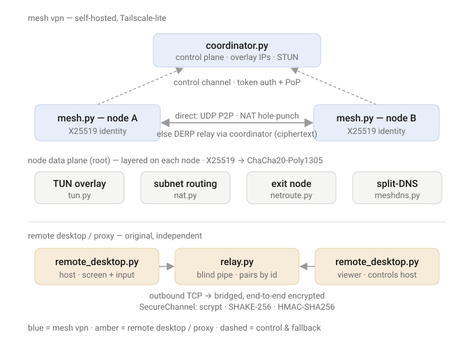
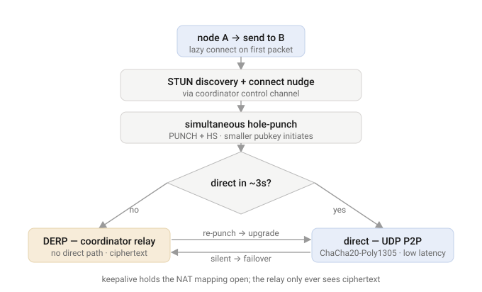
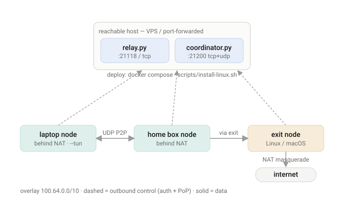

[English](README.md) | **繁體中文**

# RemoteMac self-hosted relay

本專案提供自架遠端桌面、加密 proxy 與實驗性 mesh VPN。遠端桌面與 proxy
透過 relay 連線，受控機不需要開放 inbound port。

> **只想快點跑起來?** 看 **[INSTALL.zh-TW.md](INSTALL.zh-TW.md)** —— 一步步的安裝與部署指南(Docker 或手動)。

| 檔案 | 角色 | 執行位置 |
|---|---|---|
| `relay.py` | 中繼伺服器（盲管道）| 你控制的 VPS / 家用主機 |
| `remote_desktop.py` | 加密傳輸層 + 遠端桌面 + SOCKS5 proxy（五種模式）| Mac / Linux |
| `coordinator.py` | Mesh 控制平面與 STUN 回應器 | 對外可達的 VPS / 家用主機 |
| `mesh.py` | 加密 mesh 節點，可選用 TUN 與 gateway | Mac / Linux / Windows client |
| `mac-native/` | 對應 Python 遠端桌面 host 的 Swift 原生 viewer | macOS |

遠端桌面 / proxy 連線：

```
 Machine A  ──outbound──►  YOUR RELAY  ◄──outbound──  Machine B
  (client)    (encrypted)    (blind)     (encrypted)    (host)
```

---

## 架構說明

整體系統 —— mesh VPN(coordinator 控制平面 + 節點的 UDP P2P 資料面)與最初的遠端桌面 / proxy:



<details><summary>更多圖 —— 資料面連線流程與部署拓撲</summary>

資料面:打洞與透明的 direct↔DERP 切換 —



部署:各元件執行位置 —



</details>

### relay.py — 盲管道

Relay 只做一件事：把兩條 outbound TCP 連線配對，然後把位元組雙向轉發。它**永遠看不到明文**，因為加解密在兩端進行。

- 不需要資料庫、不儲存任何資料
- 以 `nobody` 身分執行（systemd unit 已設定）
- 內建 DoS 防護：每 IP 最多 5 條同時連線、最多 10,000 組已登記主機

Python host 可在 relay 和 host 設定相同的強密鑰 `REMOTEMAC_RELAY_HOST_TOKEN`。relay 會先用隨機挑戰驗證 host，才保留裝置 ID。現有 Mac/iPad host app 尚不支援這項延伸協議，使用它時請勿設定此變數。舊協議下，知道裝置 ID 的人可搶先佔用 relay 登記位置。

### remote_desktop.py — 加密通道 + 遠端桌面

在 relay 建立橋接之後，`remote_desktop.py` 在上面跑一層**雙向認證 + 加密**協議：

```
[relay 橋接建立 → 'P']
        │
        ▼
① 交換隨機 nonce（各 32 bytes）
        │
        ▼
② scrypt 密鑰推導
   master = scrypt(PSK, salt=nonce_h‖nonce_c, N=16384, r=8, p=1)
   → 5 組獨立子密鑰（enc_h2c、enc_c2h、mac_h2c、mac_c2h、auth）
        │
        ▼
③ 雙向 token 交換
   token = HMAC-SHA256(auth_key, role‖nonce_h‖nonce_c)
   雙方以 compare_digest 驗證 → 任一方不知道 PSK 即中斷
        │
        ▼
④ 資料傳輸（每個 frame）
   ┌──────────┬──────────────────────┬────────────────────┐
   │ 4 B len  │ 32 B HMAC-SHA256 MAC │ N B ciphertext     │
   └──────────┴──────────────────────┴────────────────────┘
   加密：SHAKE-256 XOF counter-mode（111 MB/s，一個 Keccak call/frame）
   驗整：HMAC-SHA256(mac_key, seq_num‖ciphertext)，seq_num 防 replay
```

---

## 安全性摘要

| 威脅 | 對策 |
|---|---|
| 竊聽 relay 流量 | SHAKE-256 加密，relay 只看到密文 |
| 中間人偽裝 | 雙向 token 驗證，雙方都必須知道 PSK |
| 弱 PSK 暴力破解 | scrypt(N=16384) 讓每次猜測耗時 ~50 ms + 16 MB RAM |
| Frame 偽造/竄改 | HMAC-SHA256 per-frame MAC，constant-time 比對 |
| Replay 攻擊 | 單調遞增 64-bit 序號，每個方向獨立 |
| Frame flooding | 接收端每秒最多 5,000 frames 限制 |
| 連線佔用 | Auth 30 秒逾時；閒置 120 秒斷線 |
| 大 frame 炸記憶體 | 單一 frame 上限 4 MB |

> **注意**：remote_desktop.py 的加密層與 RemoteMac app 的 TLS-PSK 無關，兩者是獨立的加密層。remote_desktop.py 是獨立的遠端桌面 / 加密管道工具，不是取代 app。

---

## 需求

- Python 元件需 Python 3.8+。relay 與 `pipe` / `gateway` / `socks` 模式免 pip 套件；
  mesh 需安裝 `cryptography`。
- Python 桌面 `host` / `viewer` 模式分別需要 `mss Pillow pynput` / `Pillow`；
  原生 viewer 需 macOS 與 Swift 工具鏈才能編譯。
- Relay 伺服器必須從網際網路可以連到（VPS，或家用主機有做 port forwarding）

---

## 一、架設 relay.py（伺服器端）

### 0. 確認 Python 版本

```bash
python3 --version   # 需要 3.8 以上
```

如果沒有：

```bash
# Debian / Ubuntu / Raspberry Pi OS
sudo apt update && sudo apt install -y python3

# Fedora / RHEL / CentOS / Rocky / Alma
sudo dnf install -y python3

# Arch / Manjaro
sudo pacman -S --noconfirm python

# Alpine
sudo apk add python3
```

### 1. 把檔案複製到伺服器

```bash
scp relay.py remotemac-relay.service you@YOUR_SERVER:~/
```

### 2. 先測試（前景執行）

```bash
ssh you@YOUR_SERVER
python3 relay.py 21118
# 應該看到：RemoteMac relay listening on 0.0.0.0:21118
```

確認 port 有在監聽：

```bash
ss -tlnp | grep 21118
```

按 **Ctrl-C** 停止。

### 3. 安裝成 systemd 服務（建議）

```bash
sudo mkdir -p /opt/remotemac
sudo cp relay.py /opt/remotemac/
sudo cp remotemac-relay.service /etc/systemd/system/
sudo systemctl daemon-reload
sudo systemctl enable --now remotemac-relay
sudo systemctl status remotemac-relay        # 確認 active (running)
```

看即時 log：

```bash
journalctl -u remotemac-relay -f
# host registered → Mac 已連線
# bridging        → 有 session 正在進行
```

沒有 systemd（Alpine / container / WSL）：

```bash
mkdir -p ~/.local/state/remotemac
nohup python3 /opt/remotemac/relay.py 21118 > ~/.local/state/remotemac/relay.log 2>&1 &
```

換 port：編輯 `/etc/systemd/system/remotemac-relay.service` 的 `ExecStart=`，然後：

```bash
sudo systemctl daemon-reload && sudo systemctl restart remotemac-relay
```

### 4. 開防火牆

```bash
# ufw（Debian/Ubuntu）
sudo ufw allow 21118/tcp

# firewalld（Fedora/RHEL）
sudo firewall-cmd --add-port=21118/tcp --permanent && sudo firewall-cmd --reload

# iptables
sudo iptables -A INPUT -p tcp --dport 21118 -j ACCEPT
```

雲端 VM（AWS / GCP / Azure / DigitalOcean）還需要在控制台的 Security Group / 防火牆規則開放 21118/tcp inbound。

### 5. 確認可從外部連到

```bash
# 在伺服器上查公網 IP
curl -s https://api.ipify.org; echo

# 從另一台機器測試（例如你的 Mac）
nc -vz YOUR_RELAY_IP 21118     # 應該顯示 succeeded / open
```

### 管理服務

```bash
sudo systemctl restart remotemac-relay
sudo systemctl stop remotemac-relay
sudo systemctl disable --now remotemac-relay
journalctl -u remotemac-relay -e          # 看最近的 log
```

更新 relay：

```bash
sudo cp relay.py /opt/remotemac/ && sudo systemctl restart remotemac-relay
```

完全移除：

```bash
sudo systemctl disable --now remotemac-relay
sudo rm /etc/systemd/system/remotemac-relay.service /opt/remotemac/relay.py
sudo systemctl daemon-reload
```

---

## 用 Docker 部署伺服器（relay + coordinator）

兩個伺服器 daemon —— `relay.py` 與 mesh `coordinator.py` —— 以非 root 容器執行(映像會幫 coordinator 裝 `cryptography`;relay 是純 stdlib)。一鍵拉起:

```bash
cp docker/.env.example .env          # 然後把 REMOTEMAC_MESH_TOKEN 設成強密碼
docker compose up -d --build
docker compose logs -f               # relay + coordinator 的 log
```

- **relay** 監聽 `21118/tcp`;**coordinator** 監聽 `21200`(tcp 控制 + udp STUN)。記得在防火牆 / 雲端 security group 開這些埠。
- mesh token 透過 `REMOTEMAC_MESH_TOKEN`(來自 `.env`)傳入,**不會**烤進映像;所有 mesh 節點要用同一個 token。
- coordinator 的 overlay IP 配發持久化在 `coordinator-state` volume,節點重啟後仍保留 IP。
- 只容器化 relay + coordinator。帶 `--tun` 的 mesh 節點(`--exit` / subnet router)需要 `NET_ADMIN` + `/dev/net/tun`,遠端桌面 `host` 模式需要真實桌面 —— 這些直接跑在主機上。

```bash
docker compose down                  # 停止;加 -v 連 state volume 一起刪
```

---

## 二、設定 RemoteMac app（Mac + iPad）

本節適用於已持有舊版 Mac 與 iPad app 的使用者；本 repo 不包含這兩個 app
的原始碼或執行檔。使用此 repo 的 Python host/viewer 或 Swift viewer 請看第三節。

### Mac 端

```bash
echo "YOUR_RELAY_IP:21118" > ~/.config/remotemac/relay
pkill -9 -f "RemoteMac Host.app"
open -W "/Applications/RemoteMac Host.app"
```

Relay log 應出現：`host registered id=...`

### iPad 端

**Settings ▸ Relay server** → 輸入 `YOUR_RELAY_IP:21118`。

### 連線流程

1. iPad 輸入 Device Code。
2. 同一個 Wi-Fi → 直接 LAN 連線（最快），relay 不會用到。
3. 不同網路 / 行動網路 → 雙方連到 relay → 橋接 → 進入。

---

## 三、使用 remote_desktop.py

`remote_desktop.py` 整合了加密傳輸層、遠端桌面與加密 proxy 功能，支援五種模式：

| 模式 | 說明 | 相依套件 |
|---|---|---|
| `host` | 被控端：串流螢幕 + 接收注入鍵鼠 | `mss Pillow pynput` |
| `viewer` | 控制端：顯示畫面 + 發送鍵鼠 | `Pillow`（含 tkinter）|
| `pipe` | stdin/stdout 加密橋接，無 GUI | 無（Python stdlib 即可）|
| `gateway` | 出口節點：代 client 對外建立 TCP/UDP 連線 | 無（Python stdlib 即可）|
| `socks` | 本機 SOCKS5 proxy 入口，讓其它 app 走加密隧道出去 | 無（Python stdlib 即可）|

### 安裝相依套件（host / viewer 模式）

```bash
pip install mss Pillow pynput
```

### macOS 原生 viewer

[`mac-native/`](mac-native/) 已包含對應 `remote_desktop.py host` 的 AppKit viewer。
在 macOS 執行 `./mac-native/build-app.sh` 會產生
`mac-native/dist/RemoteMac Viewer.app`。Swift 與 Python 的加密傳輸互通測試已通過；
畫面、輸入與雙向純文字剪貼簿同步仍需搭配真實 host 實測；剪貼簿程式已接上。編譯及連線方式見
[原生 viewer 指南](mac-native/README.md)。

### macOS 權限設定

| 端 | 需要的權限 |
|---|---|
| host | **螢幕錄製**（System Preferences > Privacy > Screen Recording）|
| host | **輔助使用**（System Preferences > Privacy > Accessibility）— 鍵鼠注入 |

### 啟動遠端控制

```bash
# 1. Host 端先執行（被控端，等待連入）
python3 remote_desktop.py host relay.example.com:21118 mydevice --psk "strong-passphrase"

# 2. Viewer 端執行（控制端）
python3 remote_desktop.py viewer relay.example.com:21118 mydevice --psk "strong-passphrase"
```

Host 模式預設**常駐**：viewer 斷線後會自動重新向 relay 註冊、等待下一次連入；連不上 relay 時以指數退避（2s → 30s）重試。加 `--once` 可恢復「單次 session 後結束」的行為。

> **安全提醒**：`--psk` 傳入的值在 Linux 上可以被 `ps aux` 看到。更安全的方式：
> - 省略 `--psk`，程式會互動式提示輸入（不顯示在螢幕）
> - 或設定環境變數：`export REMOTEMAC_PSK="your-passphrase"`，然後省略 `--psk`

成功後：
```
[remotemac] relay: registered — waiting for peer…    ← host 端
[remotemac] auth: mutual authentication succeeded ✓

[remotemac] relay: bridge established                 ← viewer 端
[remotemac] auth: mutual authentication succeeded ✓
```

Viewer 端會開啟視窗顯示 host 的螢幕，你的滑鼠鍵盤操作即時傳到 host。

### 選項

| 參數 | 適用模式 | 說明 | 預設值 |
|---|---|---|---|
| `--fps N` | host | 擷取幀率 | 15 |
| `--quality N` | host | JPEG 品質 20–95 | 75 |
| `--once` | host | 單次 session 後結束（預設為常駐重新註冊）| 關 |
| `--no-clip` | host / viewer | 停用雙向剪貼簿同步 | 關（同步開啟）|

```bash
# 高畫質（需較好的網路）
python3 remote_desktop.py host relay.example.com:21118 myid --psk "pw" --fps 30 --quality 85

# 省頻寬
python3 remote_desktop.py host relay.example.com:21118 myid --psk "pw" --fps 10 --quality 60
```

### 支援的輸入

| 類型 | 說明 |
|---|---|
| 滑鼠移動 | 全螢幕座標正規化，自動適配不同解析度 |
| 左 / 右 / 中鍵 | 按下與放開 |
| 滾輪 | macOS / Linux / Windows 皆支援 |
| 鍵盤 | 一般字元 + F1–F12 + Ctrl / Alt / Shift / ⌘ / 方向鍵等 |
| 剪貼簿 | 雙向自動同步（純文字，每秒偵測變更；`--no-clip` 停用）|

### Pipe 模式（CLI 工具 / 腳本整合）

不需要 GUI，只用 stdin/stdout 橋接，適合傳檔、遠端執行指令等場合：

```bash
# 傳送檔案（host 端傳到 client 端）
cat file.bin | python3 remote_desktop.py pipe relay.example.com:21118 myid host --psk "pw"
python3 remote_desktop.py pipe relay.example.com:21118 myid client --psk "pw" > output.bin

# 遠端執行 bash
bash | python3 remote_desktop.py pipe relay.example.com:21118 myid host --psk "pw"
python3 remote_desktop.py pipe relay.example.com:21118 myid client --psk "pw"
```

### 加密 SOCKS5 Proxy（gateway / socks 模式）

除了遠端桌面，也可以把 client 機器上的其它 app（瀏覽器、curl…）的流量**經加密隧道從 host 出去**，等同自架的加密 `ssh -D`。多條連線多工在同一條 relay 橋接上，全程沿用同一套加密（scrypt 認證 + SHAKE-256 + HMAC），relay 仍只看到密文。

```bash
# 1. gateway（出口機，例如家裡的 Mac；預設常駐，斷線自動重連）
python3 remote_desktop.py gateway relay.example.com:21118 myproxy --psk "pw"

# 2. socks（本機，開一個本機 SOCKS5 proxy）
python3 remote_desktop.py socks relay.example.com:21118 myproxy --psk "pw" --port 1080

# 3. 讓 app 走 proxy（socks5h → 連 DNS 解析也走遠端）
curl -x socks5h://127.0.0.1:1080 https://api.ipify.org        # 顯示的是 gateway 端的公網 IP
ALL_PROXY=socks5h://127.0.0.1:1080 curl https://example.com
```

瀏覽器直接設 SOCKS5 host `127.0.0.1`、port `1080` 即可全域走隧道。

- **支援**：TCP（SOCKS5 CONNECT）+ UDP（SOCKS5 UDP associate，如 DNS/QUIC）；網域名稱在 gateway 端解析。
- **安全**：任何連進 gateway 的一方都必須通過 PSK 雙向認證，未通過即斷線，所以不會變成開放 proxy。

| 參數 | 適用模式 | 說明 | 預設值 |
|---|---|---|---|
| `--port N` | socks | 本機 SOCKS5 監聽埠 | 1080 |
| `--bind ADDR` | socks | 本機監聽位址 | 127.0.0.1 |
| `--allow HOST/CIDR` | gateway | 白名單（網域字尾或 IP/CIDR），可重複；不給則全通 | 無（全通）|
| `--once` | gateway | 單次 session 後結束（預設常駐重連）| 關 |

> **防護縱深**：`socks` 預設只監聽 `127.0.0.1`，別台機器無法白嫖你的 proxy；改 `--bind 0.0.0.0` 對外開放前請三思。`gateway` 想再收斂可用 `--allow`（例如 `--allow example.com --allow 10.0.0.0/8`）限定可連目標，未列的一律拒絕。

### PSK 選擇建議

| 強度 | 範例 |
|---|---|
| 弱（不建議）| `1234`、`password` |
| 可接受 | `correct-horse-battery-staple` |
| 強（建議）| `python3 -c "import secrets; print(secrets.token_hex(24))"` |

---

## 四、Mesh overlay（實驗性）

除了 1:1 遠端桌面,`coordinator.py` + `mesh.py` 把系統擴充成 **mesh**(自架的簡化版 Tailscale):多個節點加入同一張網,各自拿到穩定的 overlay IP,節點之間端到端加密,而且在網路允許時**走 UDP P2P 直連**而非繞經 coordinator。需要 `cryptography`(`pip install cryptography`)。

```bash
# Coordinator(放在對外可達的主機 — 控制平面 + STUN,只看得到密文)
python3 coordinator.py 21200 --token "network-secret"

# 每個節點加入網路(會開一個 UDP 資料面埠;要固定用 --udp-port)
python3 mesh.py up coord.example.com:21200 --token "network-secret" --name laptop
python3 mesh.py up coord.example.com:21200 --token "network-secret" --name mac

# 驗證加密路徑 —— log 會顯示 [direct: …] 或 [derp …]
python3 mesh.py up coord.example.com:21200 --token "network-secret" --ping mac
```

- 每個節點有持久的 X25519 身份(`~/.config/remotemac/mesh/key`,可用 `$REMOTEMAC_MESH_KEY` 覆寫);coordinator 從 `100.64.0.0/10` 配發 IPv4 位址,並從每個 mesh 專屬且持久保存的 ULA `/64` 配發 IPv6 位址。
- 節點間握手是雙向認證 + 前向保密(X25519 triple-DH → HKDF-SHA256 → ChaCha20-Poly1305)。INIT 本身經過認證並帶時間戳(偽造或重放的握手一律丟棄),RESP 帶金鑰確認;session 每 2 分鐘換鑰,peer 重啟後可自動恢復;直連路徑只會因「已認證且非重放的資料封包」而變更。
- **P2P 直連(Phase 2)**:節點透過向 coordinator 做 STUN-lite 探測得知自己的公網端點,互換候選端點後**同時打洞建立 UDP 直連**(以 pubkey 定序避免握手 glare)。之後資料在兩節點間直送。若數秒內打不通(例如雙方對稱 NAT),流量會**透明回退到 coordinator relay(DERP)** —— relay 全程只看得到密文。keepalive 維持 NAT 映射;直連靜默會回退 DERP,並週期性重新打洞,連通恢復時再升級回直連。
- **TUN overlay(Phase 3)**:加上 `--tun`(需 root 或 Windows 系統管理員)後,節點會開一個虛擬網卡、綁上自己的 overlay IPv4/IPv6 位址,並把兩個 overlay 網段路由過去 —— 讓**真實 app 直接用 overlay IP 連 peer**(`ping 100.64.0.x`、`ssh`、http),不再只有內建 `--ping`。核心的 IP 封包走同一條加密 P2P/DERP 資料路徑。macOS 用 `utun`(免 kext),Linux 用 `/dev/net/tun`,Windows client 用另外下載的 [Wintun DLL](https://www.wintun.net/)。peer 只能送出「來源是自己 overlay IP」的封包(anti-spoof)。
- **子網路由(Phase 4)**:節點用 `--advertise-routes` 宣告 IPv4 或 IPv6 LAN 網段;Linux 或 macOS 上會設定 IP forwarding 與 NAT/NAT66。client 必須用 `--accept-route PUBKEY,CIDR` 明確信任特定公鑰與網段,才會把路由裝到 TUN。只接受已授權且不與 overlay、coordinator 或 peer endpoint 衝突的路由。
- **出口節點(Phase 5,opt-in)**:Linux 或 macOS 出口用 `--exit` 提供 IPv4 轉送,加上 `--exit-ipv6` 可提供 IPv6 轉送與 NAT66;client 用 `--exit-node PUBKEY` 指定完整公鑰。mesh TCP/UDP 傳輸 socket 綁定實體介面,其餘預設流量經 IPv4 `/1` 路由、以及出口有支援時的 IPv6 `/1` 路由走 TUN。路由安裝失敗會中止啟動。Windows 目前只支援 overlay 與已授權子網 client,尚不支援出口或 gateway。
- **split-DNS(Phase 8,opt-in)**:加上 `--dns` 後,本機解析器在 `127.0.0.1:53` 回答 `<name>.mesh` 的 A 與 AAAA 記錄。macOS 使用 `/etc/resolver/mesh`;Linux 若有 systemd-resolved,用 `resolvectl` 只導向 `.mesh`。若是沒有其他服務管理的普通 `/etc/resolv.conf`,會暫時把所有 DNS 指到本機 resolver,其他名稱則轉送到原先的上游,結束或下次啟動時還原。由其他服務管理的檔案不會覆寫。
- **IPv6 overlay 與路由(Phases 9–11)**:節點取得穩定的 ULA 位址,IPv6 封包與 IPv4 一樣透過加密 TUN 資料路徑傳送。IPv6 子網同樣需要明確授權,出口可選 NAT66。UDP 直連及 coordinator relay 傳輸仍使用 IPv4。
- **macOS gateway(Phase 10)**:macOS 使用獨立的 PF NAT anchor 處理 IPv4/IPv6 子網與出口流量。TUN 與 NAT 就緒後才向 coordinator 宣告路由或出口;使用新版 gateway 節點前需先升級 coordinator。macOS 真實網路上的轉送尚未實測。

```bash
# 只做 overlay:兩台機器開完整資料面(root),直接用 overlay IP:
sudo python3 mesh.py up coord.example.com:21200 --token "network-secret" --name a --tun
sudo python3 mesh.py up coord.example.com:21200 --token "network-secret" --name b --tun
ping 100.64.0.3      # a → b 走 overlay;mesh log 顯示 [direct] 或 [derp]
ping6 fdab:cdef:1234::3  # 請換成 mesh log 顯示的 b 節點 IPv6 位址

# 子網路由:在 gw 執行 `sudo python3 mesh.py key` 取得完整公鑰:
sudo python3 mesh.py up coord…:21200 --token … --name gw     --tun --advertise-routes 192.168.1.0/24
sudo python3 mesh.py up coord…:21200 --token … --name laptop --tun --accept-route GW_PUBKEY,192.168.1.0/24
ping 192.168.1.1     # laptop 透過 gw 連到它背後的 LAN

# IPv6 子網:以實際 LAN 前綴取代範例:
sudo python3 mesh.py up coord…:21200 --token … --name gw --tun --advertise-routes fd20:1:2::/64
sudo python3 mesh.py up coord…:21200 --token … --name laptop --tun --accept-route GW_PUBKEY,fd20:1:2::/64

# IPv4 出口:在 exit 執行 `sudo python3 mesh.py key` 取得完整公鑰:
sudo python3 mesh.py up coord…:21200 --token … --name exit   --tun --exit
sudo python3 mesh.py up coord…:21200 --token … --name laptop --tun --exit-node EXIT_PUBKEY
curl https://ifconfig.me      # 顯示出口節點的公網 IP,而非 client 本機的

# 雙協定出口:出口的實體介面需要可用的 IPv6:
sudo python3 mesh.py up coord…:21200 --token … --name exit --tun --exit --exit-ipv6
sudo python3 mesh.py up coord…:21200 --token … --name laptop --tun --exit-node EXIT_PUBKEY

# split-DNS:用名字連 peer
sudo python3 mesh.py up coord…:21200 --token … --name laptop --tun --dns
ssh user@gw.mesh              # 解析成 gw 的 overlay IP;example.com 照常
```

Windows client 請用系統管理員終端機、安裝 `cryptography`,並把對應架構的官方
`wintun.dll` 放在 `wintun.py` 旁邊(或將 `REMOTEMAC_WINTUN_DLL` 設成絕對路徑)。
接著執行 `py -3 mesh.py up coord.example.com:21200 --token "…" --tun`。
目前 Windows 支援 overlay 與明確授權的子網路由;出口、gateway 及自動 OS DNS 設定仍需 macOS 或 Linux。

**參數**:`--bind` 設定 UDP 綁定位址;`--udp-port` 固定 UDP 埠。`--tun` 啟用 VPN 介面,`--tun-mtu` 與 `--tun-name` 可微調。`--advertise-routes CIDR,…` 宣告 IPv4/IPv6 子網;重複使用 `--accept-route PUBKEY,CIDR` 授權特定 peer 的特定網段。`--exit` 宣告 IPv4 出口,`--exit-ipv6` 同時開 IPv6,`--exit-node PUBKEY` 用完整公鑰選出口;`--allow-ipv6-bypass` 明確允許 IPv6 直連。`--lan-routes CIDR,…` 保留額外本地網段;`--dns` 啟用 split-DNS,可用 `--dns-suffix`、`--dns-upstream` 微調;`--egress IFACE` 覆寫 NAT 出口介面。

> **Full-tunnel 注意事項**:它會改寫預設路由 —— 請在有 console/SSH 備援下測試。程序崩潰時兩條 `/1` 會隨 TUN 消失,預設路由自動恢復。DNS 走出口(公用 resolver 可用;LAN resolver 不行)。**直接連接的本地區網仍可達**(其 connected 路由比 `0.0.0.0/1`+`128.0.0.0/1` 更明確);只有原本要走預設閘道的流量才走隧道。若要讓**其他**經由 LAN 路由器才到的本地網段也保持可達,用 `--lan-routes 10.0.0.0/8,172.16.0.0/12` 列出。
> 若出口只有 IPv4,啟動時已有 IPv6 預設路由會拒絕啟動;明確指定 `--allow-ipv6-bypass` 才會讓 IPv6 直連。出口若加 `--exit-ipv6`,client 會安裝 `::/1` 與 `8000::/1`。NAT66 需要出口實體介面有可用 IPv6。

**狀態 / 藍圖**:Phase 1–10 已加入控制平面、P2P、TUN、子網、出口、split-DNS、IPv6 overlay 與 macOS PF NAT。目前開發版再加入 IPv6 子網與出口、原生 viewer 剪貼簿、Linux 靜態 DNS 後援及 Windows Wintun client。純 Python 資料面吞吐中等,一般用途足夠。

---

## 效能

在一般開發機上測得的加密吞吐量（4 MB frame）：

| 項目 | 速度 |
|---|---|
| XOR（big-integer）| ~140 MB/s |
| SHAKE-256 加密 | ~111 MB/s |
| Auth 握手（scrypt） | ~50 ms（一次性）|
| 遠端桌面典型頻寬 | 1–8 MB/s（JPEG @75, 1080p, 15fps）|

加密開銷遠低於實際串流頻寬，瓶頸在網路而非 CPU。

---

## 疑難排解

| 症狀 | 檢查 |
|---|---|
| iPad 顯示「Mac … is offline」 | Relay log 沒有 `host registered` → Mac 的 `~/.config/remotemac/relay` 設錯，或 Mac 連不到 relay |
| `nc -vz` 從外部超時 | 防火牆 / Security Group / 路由器 port forwarding 沒開 |
| Wi-Fi 可連、行動網路不行 | Relay 沒有真正的公網路徑（家用主機沒做 port forwarding）|
| 服務啟動失敗 | `journalctl -u remotemac-relay -e` → 通常是 Python 路徑錯誤或 port 被佔用 |
| auth failed: peer does not know the PSK | 兩端 PSK 不一致，或 device_id 不同 |
| relay: host slot occupied | 已有同 device_id 從不同 IP 登記；換 device_id 或等舊連線逾時 |
| MAC verification failed | 網路中間有人篡改封包，或版本不相容 |
| remote_desktop 螢幕全黑 | Host 沒有 Screen Recording 權限 |
| remote_desktop 鍵鼠無反應 | Host 沒有 Accessibility 權限 |
| remote_desktop 連線後立即斷開 | 檢查 PSK 是否兩端一致；查看 stderr 輸出 |
| socks / gateway 連不上 | 兩端 device_id 與 PSK 需一致；gateway 要先啟動並向 relay 註冊 |
| curl 走 proxy 卻解析失敗 | 用 `socks5h://`（h 代表 DNS 走遠端），不要用 `socks5://` |

---

## 檔案列表

| 檔案 | 說明 |
|---|---|
| `relay.py` | 中繼伺服器，Python 3.8+，無相依套件 |
| `remote_desktop.py` | 加密傳輸層 + 遠端桌面 + SOCKS5 proxy（host / viewer / pipe / gateway / socks 五種模式）|
| `coordinator.py` | Mesh 控制平面 — 節點註冊、overlay IP 配發、端點分發、STUN 回應器、DERP 轉發。需 `cryptography` |
| `mesh.py` | Mesh 節點 — X25519 身份、UDP P2P 資料面 + NAT 打洞 + direct↔DERP 切換、TUN overlay(`--tun`)。需 `cryptography` |
| `tun.py`、`wintun.py` | overlay 的 TUN 虛擬網卡(macOS `utun` / Linux `/dev/net/tun` / Windows Wintun)—— 供 `mesh.py --tun` 使用。需 root 或系統管理員 |
| `nat.py` | subnet router / 出口節點的 Linux NAT egress(`--advertise-routes` / `--exit`)—— IP forwarding + masquerade(nftables,或 iptables 後援)。需 root |
| `macnat.py` | macOS PF NAT egress — 獨立 anchor、IP forwarding、崩潰後復原。需 root |
| `netroute.py` | IPv4/IPv6 出口路由管理(`--exit-node`)—— 檢查路由安裝結果、socket 綁定實體介面。需 root |
| `meshdns.py` | split-DNS 解析器(`--dns`)—— macOS `/etc/resolver`、Linux `resolvectl` 或未受管理的靜態 `resolv.conf`。需 root |
| `mac-native/` | Swift macOS viewer app 與無介面的互通測試 client；連接 Python `remote_desktop.py host` |
| `remotemac-relay.service` | systemd unit，讓 relay.py 開機自動啟動 |
